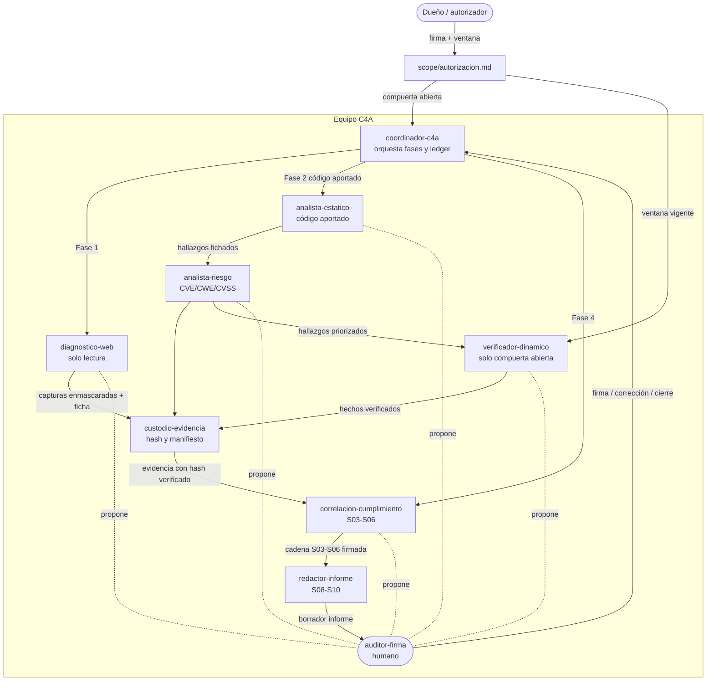

# Equipo C4A — Roles, agentes, skills, MCP y herramientas locales

**Versión**: 1.0.0 (2026-10-27). **Autoridad**: `.specify/memory/constitution.md` (principios
I–VIII) → `docs/LINEA_ORIGEN.md` → `docs/PROMPT_SPEC_KIT.md` →
`docs/INSTRUCCION_AUDITORIA_CURSO.md`. Este documento **amplía** esa instrucción; no la
contradice. El catálogo justificado de herramientas está en
[`CATALOGO_HERRAMIENTAS_AUDITORIA.md`](CATALOGO_HERRAMIENTAS_AUDITORIA.md).

## Regla rectora

> **La herramienta propone; el auditor firma.** Ningún agente, skill, MCP ni script cierra
> un hallazgo, aprueba una evaluación ni emite un dictamen de cumplimiento (principio I).
> Todo producto nace en estado `borrador` y solo una persona —rol **auditor-firma**— lo
> pasa a `revisado` o `firmado`, registrando quién, cuándo y con qué justificación.

## Compuertas que aplican a todo el equipo

1. **Sin `scope/autorizacion.md` firmada, completa y con ventana vigente no hay tráfico
   activo contra el objetivo** (principio V; Ley 21.459). Antes de esa firma el equipo
   opera solo en: diagnóstico de **solo lectura** (navegación/GET con la cuenta del
   auditor) y **análisis estático de código aportado**.
2. **Nadie lee `.env` con herramientas del agente.** Los scripts locales leen las
   credenciales en runtime; los valores nunca se imprimen, copian, citan ni versionan.
   En documentos solo aparecen los **nombres de las claves** (`URL_CURSO`, `USUARIO`,
   `CLAVE`).
3. En specs, issues e informes se nombran **tipos de evidencia y patrones**; nunca IP,
   comandos de ataque, puertos, credenciales ni procedimientos de explotación (V, VIII).
4. Evidencia cruda fuera de git (`evidence/`); todo hash publicado corresponde a los
   bytes persistidos (principio III).

## Roles de agente

| Rol | Misión | ¿Toca el objetivo? | Skills / MCP / CLI que usa | Entrada → Salida en disco |
|---|---|---|---|---|
| **coordinador-c4a** | Orquesta el encargo: abre y cierra fases, mantiene el ledger de corrida, vigila que cada fase consuma el producto de la anterior | Nunca | CLI `platform/c4a` (`run`, `runs`); skills `speckit-*` si el encargo se especifica como sprint S11 | `docs/INSTRUCCION_AUDITORIA_CURSO.md` + `scope/` → `.c4a/runs.jsonl` |
| **autorizador** (humano) | Completa y firma `scope/autorizacion.md`; fija la ventana y las exclusiones | Sí (es el dueño del encargo) | Ninguno: es una persona | Decisión del dueño → `scope/autorizacion.md` (firma + ventana) |
| **diagnostico-web** | Fase 1: reproduce el fallo con la cuenta del auditor, caracteriza síntoma (mensaje, código HTTP, alcance del fallo), captura pasiva | **Solo lectura** (navegación/GET; sin payloads, fuzzing ni escaneo) | Skill `diagnostico-curso`; MCP **Playwright** (headless); MCP **REA** (captura web pasiva, `inspect_web_page`); scripts `platform/tools/diagnostico_curso.py`, `platform/tools/recon_curso.py` | `.env` en runtime → `evidence/capturas_curso/` (enmascarado) + ficha de síntoma |
| **custodio-evidencia** | Garantiza integridad verificable: hash sobre los bytes persistidos, manifiesto, verificación independiente del detector | No | Skill `evidencia-integridad`; CLI `c4a verify` / `c4a reproduce` | `evidence/<run>/` → `MANIFEST.json`, `SHA256SUMS.txt`, verificación |
| **analista-estatico** | Fase 2: análisis estático del código **aportado por el cliente** (nunca extraído del objetivo): patrones php2shell/python2shell, deserialización, carga de archivos, dependencias | No | Skill `auditoria-php`; detector `php-shell` (+ `secrets-files`, `dependencies`); `composer audit` / `pip audit` sobre manifiestos aportados; MCP REA para artefactos binarios aportados (`reverse-engineer-anything`) | Código en local → hallazgos fichados (archivo/línea/patrón, sin explotación) |
| **analista-riesgo** | Cruza hallazgos con catálogo de vulnerabilidades: CVE reales por SCA, CWE, CVSS v4.0 (vector completo) | No | CLI `c4a` (`sca`, `cvss4`); `platform/c4a/knowledge/` (cwe.json, cwe_map.json) | Hallazgos → fichas en `03_hallazgos/` con CVSS y CWE |
| **verificador-dinamico** | Fase 3: verificación controlada y acotada de hallazgos, solo sobre lo autorizado | **Sí, activo limitado — solo con compuerta abierta y dentro de ventana** | CLI `c4a` con compuerta; MCP REA (capturas de escenario con consentimiento) | Hallazgos priorizados → hechos del registro (S02) con evidencia y huella |
| **correlacion-cumplimiento** | Fase 4: cadena S03–S06 sobre los hechos — enunciado, cita (marco+versión+identificador), perfil NIST CSF 2.0, lista CIS v8.1 | No | Skill `correlacion-cumplimiento`; CLI `c4a enunciado/cita/perfil/lista` | Hechos firmados → productos S03–S06 en `02_evidencia/` y `03_hallazgos/` |
| **redactor-informe** | Fase 5: las dos frases, borrador y cierre del informe, trazable hasta la evidencia | No | CLI `c4a frases/borrador/cierre`; `report.py`, `htmlmap.py`, `sarif.py` | Cadena S03–S06 → `04_informe/` (informe técnico, resumen gerencia, plan remediación, mapa, SARIF) |
| **auditor-firma** (humano) | Revisa, corrige y firma cada producto; único rol que puede cerrar un hallazgo o dictaminar; decide la publicación del informe | Decisión humana | Ninguno: es el auditor de cumplimiento | Borradores → productos `revisado`/`firmado` con registro de quién y por qué |

## Matriz RACI ligera

R = ejecuta · A = accountable (responde del resultado) · C = consultado · I = informado.
En toda fila, la **A final es humana** (auditor-firma o autorizador): la herramienta nunca
es accountable de un dictamen.

| Actividad | coordinador | autorizador | diagnostico-web | custodio-evidencia | analista-estatico | analista-riesgo | verificador-dinamico | correlacion-cumplimiento | redactor-informe | auditor-firma |
|---|---|---|---|---|---|---|---|---|---|---|
| Firmar `scope/autorizacion.md` y fijar ventana | I | **R/A** | I | I | I | I | I | I | I | C |
| Diagnóstico no invasivo del fallo (Fase 1) | A* | I | R | C | I | C | I | I | I | C |
| Cadena de custodia y verificación de hashes | I | I | C | **R** | C | C | C | C | I | A |
| Análisis estático de código aportado (Fase 2) | A* | I | I | C | **R** | C | I | C | I | C |
| Enriquecimiento CVE/CWE/CVSS | A* | I | I | C | C | **R** | C | C | I | C |
| Verificación dinámica acotada (Fase 3) | A* | I | I | C | C | C | **R** | I | I | C |
| Correlación a controles y obligaciones (Fase 4) | A* | I | I | C | C | C | I | **R** | I | C |
| Informe dual gerencia/técnico (Fase 5) | A* | I | I | I | C | C | C | C | **R** | C |
| Cerrar hallazgo / dictaminar / publicar | I | C | I | I | I | I | I | I | I | **R/A** |

\* A operativa de orquestación: el coordinador responde de que la fase se ejecute con sus
compuertas; la responsabilidad profesional del contenido sigue siendo del auditor-firma.

## Flujo entre roles y fases (diagrama)

## Cómo se activa cada MCP y qué expone

Configuración viva: `~/.kimi-code/mcp.json` (respaldo con timestamp junto al archivo).
El registro es de usuario (todos los proyectos de esta estación); no hay MCP a nivel
proyecto en el repo.

| MCP | Activación | Qué expone (familias de tools) | Lo usa |
|---|---|---|---|
| **rea** | Ya registrado: script local `rea.mjs mcp` con perfil `compact` | Observación web pasiva (inspección de página, capturas de escenario/navegador, ejecución precisa), análisis de binarios y artefactos aportados, captura de proceso/PTY | diagnostico-web (pasivo), analista-estatico (binarios aportados), verificador-dinamico (con compuerta) |
| **playwright** | Ya registrado: `playwright-mcp --headless` (requiere Node; binario en el PATH de la estación) | Navegación autenticada headless: ir a URL, snapshot de accesibilidad, clic, captura de pantalla, extracción de texto — la base del diagnóstico Fase 1 | diagnostico-web |

Scripts locales complementarios (lo que el MCP no debe hacer, bajo `platform/tools/`):

| Script | Para qué | Secreto |
|---|---|---|
| `platform/tools/diagnostico_curso.py` | Login con la cuenta del auditor y captura del síntoma; subcomandos `claves` (nombres de claves `.env`, nunca valores) y `curso` | Lee `.env` en runtime; enmascara usuario/clave y `sesskey` |
| `platform/tools/recon_curso.py` | Recon pasivo autenticado: rutas, huellas visibles, probes de solo lectura | Idem; salida con `sesskey` y credenciales enmascarados |

Ambos corren con el intérprete del venv de la estación (`~/.venv-c4a-audit`), que tiene
Playwright/Chromium instalado. Ver detalle de activación y comandos en
`docs/INSTRUCCION_AUDITORIA_CURSO.md`.

## Skills del equipo

| Skill | Estado | Rol principal |
|---|---|---|
| `speckit-specify` … `speckit-converge` (11) | Ya existen en `.agents/skills/`; no se reescriben | coordinador-c4a (ciclo SDD) |
| `auditoria-php` | Ya existe, sólida | analista-estatico |
| `diagnostico-curso` | Creada (este encargo) | diagnostico-web |
| `correlacion-cumplimiento` | Creada (este encargo) | correlacion-cumplimiento |
| `evidencia-integridad` | Creada (este encargo) | custodio-evidencia |
| `reverse-engineer-anything` (usuario) | Ya existe en el scope usuario | analista-estatico (artefactos aportados) |

## Qué ningún agente puede hacer

- Cerrar un hallazgo, dictaminar cumplimiento o publicar el informe: eso es del
  **auditor-firma** (I).
- Ejecutar tráfico activo sin compuerta (V), leer `.env` e imprimirlo, o persistir
  credenciales en cualquier artefacto.
- Acreditar un control con evidencia de otro activo o de otra corrida (III).
- Crear un segundo tablero/backlog o abrir un árbol paralelo a `platform/c4a` (VI, VII).
